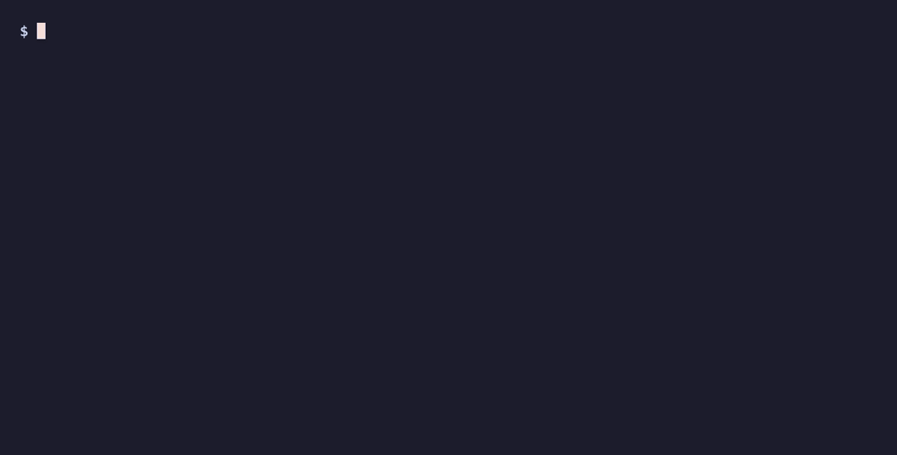

# ataegina

> Runtime isolation for git worktrees — collision-free ports, processes, **and
> databases** for every worktree, from one zero-dependency bash file. No Docker,
> no daemon, no YAML.

[](https://github.com/noahhyden/ataegina-cli/actions/workflows/ci.yml)
[](https://github.com/noahhyden/ataegina-cli/releases)
[](LICENSE)
[](#requirements)
[](#requirements)



Run several AI coding agents in parallel — or just check out three branches of a
full-stack app — and they all fight over one machine: the same ports, the same
dev server, one shared database they stomp in unison. The usual fixes cost a
container per environment, a daemon, or a hand-written compose file per project.

ataegina gives every worktree a stable index `N` and derives everything
collision-free from it:

- **Ports** — frontend `5173+N`, backend `8000+N`, sticky across runs, so
  long-lived agents keep stable addresses.
- **Database** — its own per-worktree DB, connection string injected, created on
  `up`. Deconflicting the database on the bare host is the part that otherwise
  needs a container.
- **Processes + logs** — detached servers tracked per worktree; `up` / `down` /
  `logs` act on exactly this tree's stack.

You keep your own start commands. ataegina does the deconfliction and the
bookkeeping. Named after the Lusitanian goddess of rebirth.

## Install

Never needs `sudo`; it lives under your home directory and writes only there.

```bash
brew install noahhyden/tap/ataegina                                              # Homebrew
curl -fsSL https://raw.githubusercontent.com/noahhyden/ataegina-cli/main/install.sh | sh   # or curl
```

Homebrew installs `ataegina` plus an `ate` shortcut and `brew upgrade` tracks
releases. The installer puts `ataegina` in `~/.local/bin` (override with
`ATE_BIN`), verifying its SHA-256 and `bash -n` parse-checking it first; if that
directory is not on your PATH it prints the line to add, and it never edits your
rc file for you. For the short name, `alias ate='ataegina'`.

## Quickstart

```bash
ataegina init        # detects your stack, writes ataegina.config.sh (--yes to skip prompts)
cd ../my-worktree
ataegina up          # start this tree's stack on its own slot
ataegina ports       # show this tree's index + urls
```

The primary checkout is index 0; each additional worktree gets the next free
index, and keeps it across runs:

```
frontend port = FRONT_PORT_BASE + N   (default 5173 + N)
backend  port = BACK_PORT_BASE  + N   (default 8000 + N)
log dir       = LOG_DIR_BASE + N      (default /tmp/ate-wtN)
```

`init` probes for Next, Nuxt, Astro, SvelteKit, Vite and CRA on the frontend,
and uv, Django, Rails, Express/Nest, Go, Cargo and Laravel on the backend. An
undetected stack gets a commented TODO template.

## Configuration

`init` writes a declarative config, and `ataegina config set|get|list|unset|path`
edits it without a text editor:

```sh
FRONTEND_DIR='frontend'
FRONTEND_CMD='npx next dev -p $FRONTEND_PORT'
FRONTEND_ENV='NEXT_PUBLIC_API_BASE_URL=$BACKEND_URL'
BACKEND_DIR='backend'
BACKEND_CMD='uv run uvicorn main:app --port $BACKEND_PORT'
```

`*_CMD` is a string passed to `sh -c`, so it can reference `$FRONTEND_PORT`,
`$BACKEND_PORT` and `$BACKEND_URL`. If your stack needs more than a command
string, define `ate_start_frontend` / `ate_start_backend` (and the matching
`ate_stop_*`) in the config — **a hook you define overrides the declarative
default**. Every key and both forms are worked through in
[`ataegina.config.example.sh`](ataegina.config.example.sh); `ataegina --help`
lists them too.

`ataegina env` prints this tree's derived environment as eval-able shell, and
`ataegina exec -- CMD` runs one command with it injected:

```sh
eval "$(ataegina env)" && curl "$BACKEND_URL/health"
ataegina exec -- pytest
```

## Per-worktree databases

Off unless `DB_NAME` is set. Each worktree `N>0` then gets its own database
`DB_NAME` + `DB_SUFFIX` + `N` (e.g. `myapp_wt3`), created before the backend
starts, with its URL injected as `DATABASE_URL` (or whatever `DB_URL_VAR`
names). The **primary stays on the unsuffixed name** — your shared dev DB — so
only the parallel worktrees fork off it.

```sh
DB_NAME=myapp
DB_KIND=postgres                                    # postgres | mysql | sqlite
DB_URL_TEMPLATE='postgres://localhost:5432/$ATE_DB_NAME'
```

`down` never drops a database. Manage them with
`ataegina db [name|url|create|drop]` (dropping the primary's is refused), or
define `ate_db_create` / `ate_db_drop` to call a provider's branch API instead.

## Scope-aware startup

A worktree changing only the frontend does not need its own backend — it can use
the one the primary is already serving. `up` classifies the tree's git diff as
`frontend`, `backend`, `both` or `none` and starts only what is needed:

| scope | starts locally | shares the primary's |
|---|---|---|
| `both` | frontend + backend | nothing |
| `frontend` | frontend | backend on `:BACK_PORT_BASE` |
| `backend` | backend | no frontend started |
| `none` | nothing | both defaults |

Anything changed outside both directories resolves to `both`, conservatively.
Before sharing a backend `up` checks it is actually listening, and starts a
local one if not. The primary is always `both`. Override per run with
`--scope frontend|backend|both|none`, or turn detection off with
`ATE_SCOPE_AUTO=0`.

ataegina also tells its own processes from strangers: a port held by something
it did not launch is reported as foreign, so `up` declines rather than implying
success and `down` leaves it alone unless you pass `--force`.

## For agents

Every read command speaks JSON, and `up` can block until servers actually
answer, so a supervisor gates on real state instead of a poll loop.


```bash
ataegina up --wait --json && curl "$BACKEND_URL/health"
```

`--wait` blocks until every server it launched accepts connections and **exits
`75`** if any is not ready by the deadline. `status --json` and `ports --json`
give the same slot shape for one tree, `list --json` gives the whole fleet with
`stale` / `live` per entry, and `doctor --json` emits
`{status, summary, checks[]}` with a nonzero exit, so it doubles as a CI gate.

## Commands

`ataegina --help` is the full reference, including every flag and env var.

| Command | What it does |
|---|---|
| `init` | Detect the stack and write `ataegina.config.sh` |
| `up [both\|backend\|frontend]` | Start this tree's servers; `--scope`, `--wait[=S]`, `--json` |
| `down [...] [--force]` | Stop them, reaping the whole process tree |
| `restart [...]` | `down` then `up` |
| `logs [...] [-n N]` | Follow this tree's logs |
| `db [name\|url\|create\|drop]` | Inspect or manage this tree's database |
| `ports` / `status` / `list` | This tree's slot, its liveness, the whole fleet (all `--json`) |
| `env` / `exec -- CMD` | Print the derived environment, or run a command with it |
| `open [frontend\|backend]` | Open the tree's URL in a browser |
| `move N` / `prune` | Relocate this tree to index `N`; drop entries whose worktree is gone |
| `doctor` | Read-only diagnostics; nonzero exit on a hard failure (`--json`) |
| `config <get\|set\|list\|unset\|path>` | Read or change config values |
| `update` / `completion <bash\|zsh>` | Reinstall the latest release; print a completion script |

`ataegina update` re-runs `install.sh` against the directory the running script
lives in. It never auto-updates. Load completions with
`source <(ataegina completion bash)`.

## Requirements

- `bash` 3.2+ (the macOS system shell works as-is), `git`, `awk`.
- A port backend: `lsof` preferred, falling back to `ss` or a
  `/proc/net/tcp` parse, auto-detected. Force one with `ATE_PORT_TOOL`.
- `curl` or `wget`, and `shasum` or `sha256sum`, for `update` and `install.sh`.

macOS and Linux are fully supported. On Windows use WSL2; Git Bash / MSYS2 runs
the bookkeeping and `init` but detached process tracking is unreliable there,
and native PowerShell / cmd is not supported. No runtime, no package manager, no
build step.

## Contributing

Contributions are welcome, and are expected to keep ataegina small: one bash
file, zero runtime dependencies, bash 3.2 compatible. See
[CONTRIBUTING.md](CONTRIBUTING.md) for the ground rules and the test tiers, and
the [issue templates](https://github.com/noahhyden/ataegina-cli/issues/new/choose)
for bugs and features. Changes are recorded in [CHANGELOG.md](CHANGELOG.md).

## Security

`update` downloads and replaces an executable script, so every download is
SHA-256 verified and `bash -n` parse-checked. **The config file is sourced bash
that runs with your privileges — only run ataegina in repositories you trust.**
Report a vulnerability privately through
[GitHub security advisories](https://github.com/noahhyden/ataegina-cli/security/advisories/new),
not a public issue.

## License

[Apache License 2.0](LICENSE). There is no EULA and no click-through: the
LICENSE file is the license.

The name **ataegina**, the name of this repository **ataegina-cli**, the name
**Noah Hyden**, and the project's logos are trademarks and are *not* covered by
that licence — see [TRADEMARKS.md](TRADEMARKS.md) for what's fine without
asking, and [NOTICE](NOTICE). Fork the code freely; just give your fork its own
name.

Releases up to and including v1.0.1 keep the MIT terms they shipped under.
